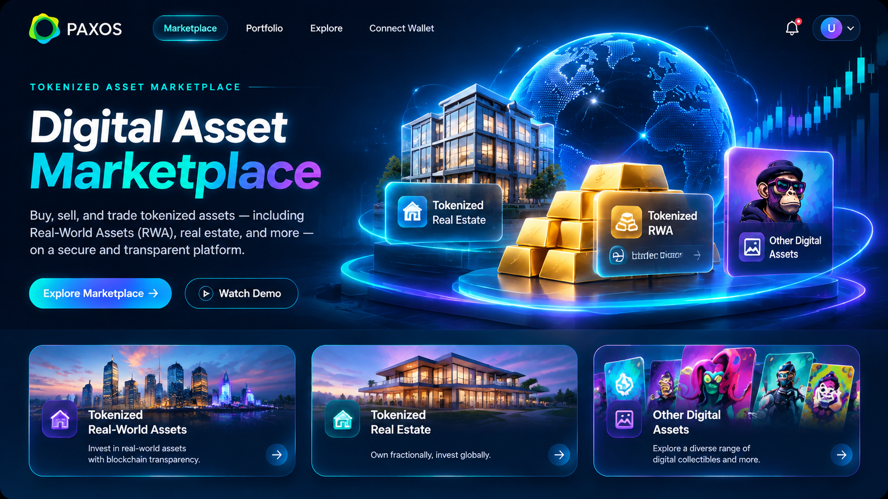
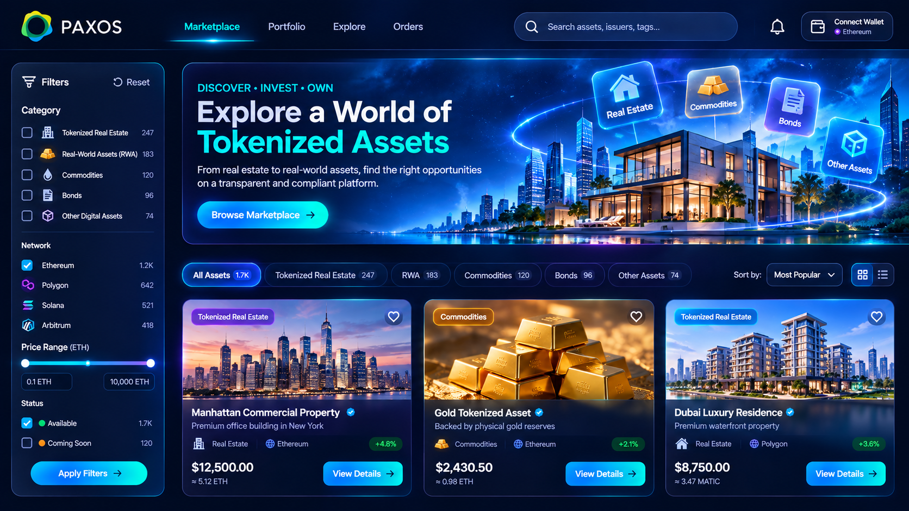
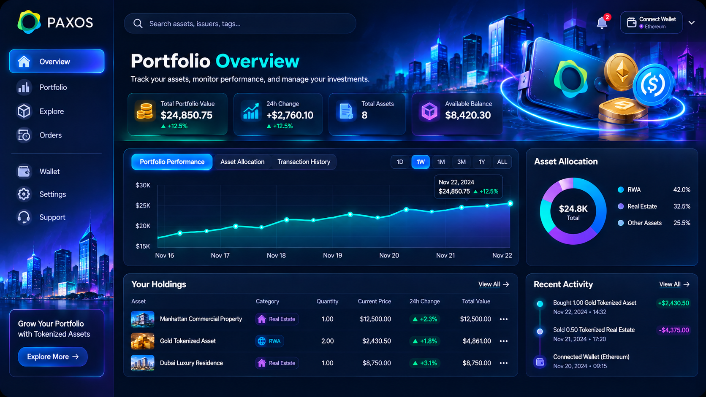
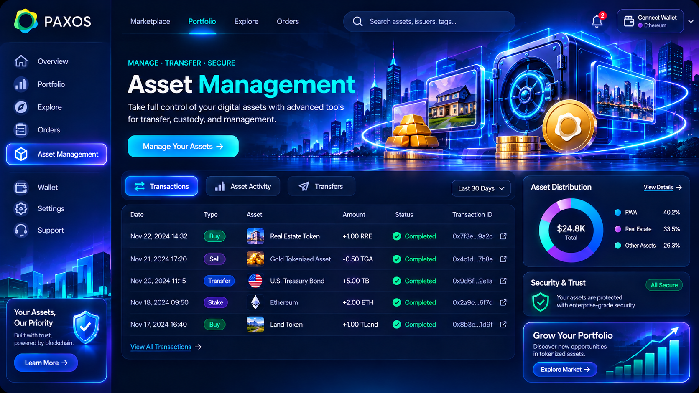

# Paxos Digital Asset Marketplace - MVP

**Paxos Digital Asset Marketplace** is a project focused on building a modern digital asset marketplace designed to connect traditional financial assets with blockchain technology. The platform aims to provide a unified environment for exploring, trading, and managing tokenized Real-World Assets (RWA), real estate, and other digital assets through transparent and blockchain-based infrastructure.

The MVP establishes the core marketplace structure and technical foundation, including asset discovery, digital ownership representation, wallet connectivity, transaction management, and portfolio tracking. It is designed to support future integrations, additional asset categories, and advanced marketplace functionality as the platform evolves.

## Project Overview

The project explores how users and businesses could discover, trade, and manage tokenized financial assets through a unified digital asset marketplace.

The platform brings together:

- Tokenized Real-World Assets (RWA) and commodities
- Tokenized real estate and fractional ownership
- Other blockchain-based digital assets
- Digital asset discovery and marketplace trading
- Wallet connectivity and blockchain transactions
- Portfolio management and asset tracking
- Order history and transaction records
- On-chain ownership verification and transparency

## Main Screens


## Platform Overview

Introduces the Paxos Digital Asset Marketplace and highlights its core features for discovering, trading, and managing tokenized assets.

| Asset Discovery | Portfolio Dashboard | Asset Management |
|:---:|:---:|:---:|
|  |  |  |

---

## Proposed Platform Modules

| Module | Purpose |
| --- | --- |
| Asset Discovery | Allow users to explore, search, and filter available tokenized assets |
| Real-World Assets (RWA) | Support the discovery and management of tokenized commodities and other real-world assets |
| Tokenized Real Estate | Represent property ownership through blockchain-based digital tokens, including fractional ownership |
| Digital Asset Marketplace | Enable users to browse asset listings, review details, and initiate purchases |
| Wallet Integration | Connect user wallets and support blockchain-based asset transactions |
| Asset Tokenization | Represent eligible real-world and digital assets as blockchain-based tokens |
| Portfolio Management | Help users track asset holdings, portfolio value, and asset allocation |
| Transaction Management | Record and display purchases, transfers, order history, and transaction statuses |
| On-chain Verification | Provide transparency into token ownership and blockchain transaction records |
| Analytics & Reporting | Present marketplace activity, asset distribution, and transaction metrics |

## Technology Stack

| Component | Technologies |
|---|---|
| Frontend | React / Next.js / TypeScript |
| Backend | Node.js |
| Database | MongoDB |
| Blockchain | Ethereum / EVM-Compatible Networks |
| Smart Contracts | Solidity / OpenZeppelin |
| Wallet Integration | Web3 Wallet Connectivity |
| Blockchain Integration | Web3.js / Ethers.js |
| Development Tools | npm / Git / GitHub |
| Testing | Jest / Hardhat |

## Getting started

```bash
# 1. Install Backend dependencies
npm install

# 2. Install Frontend dependencies
cd client
npm install
npm run build
cd ..

# 3. Launch Project
npm start
```

## References

- Paxos: https://www.paxoslabs.com/
